# AIC · 从大语言模型到 RSI

28 个专题 · 168 张动效卡。仓库首页可浏览循环预览，点击图片打开对应章节的交互版。

[完整知识点目录](./knowledge-motion/KNOWLEDGE-MAP.md) · [打开交互播放器](https://f1ndwang.github.io/AIC/knowledge-motion/)

## 先做两个算例

每章包含一道预测题和四步演示。先选答案，再逐步观察数据怎么变、为什么变。

[](https://f1ndwang.github.io/AIC/knowledge-motion/?topic=transformer-architecture)

### 01 · RSI 记忆演化、隔离与回滚

[](https://f1ndwang.github.io/AIC/knowledge-motion/?topic=rsi-memory-control)

## 模型基础

### 02 · 大语言模型基础

### 03 · 分词与输入编码

[](https://f1ndwang.github.io/AIC/knowledge-motion/?topic=tokenization)

### 04 · Transformer 架构

[](https://f1ndwang.github.io/AIC/knowledge-motion/?topic=transformer-architecture)

## 预训练与部署

### 05 · 预训练数据工程

[](https://f1ndwang.github.io/AIC/knowledge-motion/?topic=training-data)

### 06 · 预训练与推理

[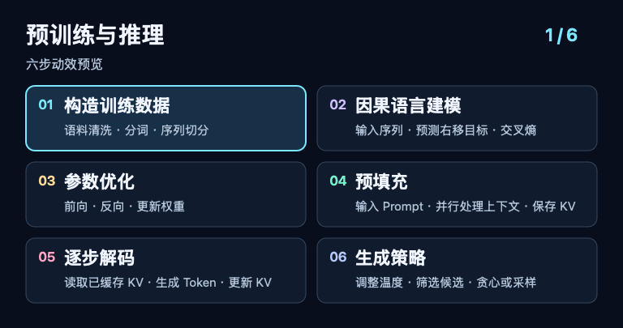](https://f1ndwang.github.io/AIC/knowledge-motion/?topic=pretraining-inference)

### 07 · 规模化训练与 MoE

[](https://f1ndwang.github.io/AIC/knowledge-motion/?topic=scaling-training)

### 08 · 高效推理与服务

[](https://f1ndwang.github.io/AIC/knowledge-motion/?topic=efficient-serving)

### 09 · 解码策略与结构化输出

### 10 · 长上下文与上下文工程

## 后训练、推理与多模态

### 11 · LLM 后训练关键检查点

### 12 · 指令微调与参数高效适配

[](https://f1ndwang.github.io/AIC/knowledge-motion/?topic=sft-peft)

### 13 · 偏好对齐与强化学习

[](https://f1ndwang.github.io/AIC/knowledge-motion/?topic=preference-rl)

### 14 · 可验证奖励与奖励漏洞

### 15 · 推理方法与模型评估

[](https://f1ndwang.github.io/AIC/knowledge-motion/?topic=reasoning-evaluation)

### 16 · 多模态大语言模型

## RAG 与 Agent

### 17 · RAG 检索增强生成

### 18 · 知识库构建与索引更新

### 19 · 检索融合与证据重排

### 20 · Agent 规划、工具与执行

[](https://f1ndwang.github.io/AIC/knowledge-motion/?topic=agent-planning)

### 21 · 工具协议、权限与抗注入

[](https://f1ndwang.github.io/AIC/knowledge-motion/?topic=tool-protocols)

### 22 · AI Agent 工具调用与可靠性

### 23 · Agent 记忆与上下文工程

### 24 · Agent 验证、评估与安全

[](https://f1ndwang.github.io/AIC/knowledge-motion/?topic=agent-verification)

### 25 · Agent 评估、统计与故障定位

## 自我改进与 RSI

### 26 · 从反思到自我改进

[](https://f1ndwang.github.io/AIC/knowledge-motion/?topic=self-improvement)

### 27 · RSI 递归自我改进

### 28 · RSI 实验设计与失效分析

[](https://f1ndwang.github.io/AIC/knowledge-motion/?topic=rsi-evaluation)

[项目源码与运行说明](./knowledge-motion/README.md)
