# AIC · 从大语言模型到 RSI

42 个专题 · 252 张动效卡。仓库首页可浏览循环预览，点击图片打开对应章节的交互版。

[完整知识点目录](./knowledge-motion/KNOWLEDGE-MAP.md) · [打开交互播放器](https://f1ndwang.github.io/AIC/knowledge-motion/)

## 先做两个算例

每章包含一道预测题和四步演示。先选答案，再逐步观察数据怎么变、为什么变。

### 01 · RSI 记忆演化、隔离与回滚

### 02 · RSI 的改进对象与策略选择

[](https://f1ndwang.github.io/AIC/knowledge-motion/?topic=rsi-strategy-selection)

### 03 · RSI 的迁移、遗忘与长期收益

[](https://f1ndwang.github.io/AIC/knowledge-motion/?topic=rsi-transfer)

### 04 · RSI 的配对评估与可信结论

[](https://f1ndwang.github.io/AIC/knowledge-motion/?topic=rsi-paired-eval)

## 模型基础

### 05 · 大语言模型基础

### 06 · 分词与输入编码

### 07 · Transformer 架构

## 预训练与部署

### 08 · 预训练数据工程

### 09 · 预训练与推理

### 10 · 规模化训练与 MoE

### 11 · 训练优化与数值稳定性

[](https://f1ndwang.github.io/AIC/knowledge-motion/?topic=optimization-stability)

### 12 · 高效推理与服务

### 13 · 模型压缩与部署验收

[](https://f1ndwang.github.io/AIC/knowledge-motion/?topic=model-compression)

### 14 · 推理显存与延迟实算

[](https://f1ndwang.github.io/AIC/knowledge-motion/?topic=serving-calculations)

### 15 · 投机解码：验收、补分布与加速

[](https://f1ndwang.github.io/AIC/knowledge-motion/?topic=speculative-sampling)

### 16 · 解码策略与结构化输出

[](https://f1ndwang.github.io/AIC/knowledge-motion/?topic=decoding-controls)

### 17 · 长上下文与上下文工程

[](https://f1ndwang.github.io/AIC/knowledge-motion/?topic=context-engineering)

### 18 · 长上下文中的证据可靠性

[](https://f1ndwang.github.io/AIC/knowledge-motion/?topic=evidence-reliability)

## 后训练、推理与多模态

### 19 · LLM 后训练关键检查点

[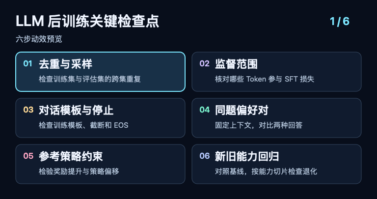](https://f1ndwang.github.io/AIC/knowledge-motion/?topic=llm-post-training)

### 20 · 指令微调与参数高效适配

### 21 · 偏好对齐与强化学习

### 22 · DPO 损失与偏好信号实算

[](https://f1ndwang.github.io/AIC/knowledge-motion/?topic=dpo-calculations)

### 23 · GRPO：优势、裁剪和参考约束

[](https://f1ndwang.github.io/AIC/knowledge-motion/?topic=grpo-objective)

### 24 · 可验证奖励与奖励漏洞

[](https://f1ndwang.github.io/AIC/knowledge-motion/?topic=verifiable-reward)

### 25 · 推理方法与模型评估

### 26 · 推理搜索与预算分配

[](https://f1ndwang.github.io/AIC/knowledge-motion/?topic=inference-search)

### 27 · 多模态大语言模型

[](https://f1ndwang.github.io/AIC/knowledge-motion/?topic=multimodal-llm)

## RAG 与 Agent

### 28 · RAG 检索增强生成

### 29 · 知识库构建与索引更新

[](https://f1ndwang.github.io/AIC/knowledge-motion/?topic=rag-ingestion)

### 30 · 检索融合与证据重排

[](https://f1ndwang.github.io/AIC/knowledge-motion/?topic=retrieval-ranking)

### 31 · RRF 实算：两路召回到一个排序

[](https://f1ndwang.github.io/AIC/knowledge-motion/?topic=rrf-ranking)

### 32 · Agent 规划、工具与执行

### 33 · 工具协议、权限与抗注入

### 34 · Agent 威胁建模与安全验收

[](https://f1ndwang.github.io/AIC/knowledge-motion/?topic=agent-security)

### 35 · Agent 工作流、恢复与并发

[](https://f1ndwang.github.io/AIC/knowledge-motion/?topic=agent-workflows)

### 36 · AI Agent 工具调用与可靠性

### 37 · Agent 记忆与上下文工程

[](https://f1ndwang.github.io/AIC/knowledge-motion/?topic=agent-memory)

### 38 · Agent 验证、评估与安全

### 39 · Agent 评估、统计与故障定位

[](https://f1ndwang.github.io/AIC/knowledge-motion/?topic=agent-eval-design)

## 自我改进与 RSI

### 40 · 从反思到自我改进

### 41 · RSI 递归自我改进

### 42 · RSI 实验设计与失效分析

[项目源码与运行说明](./knowledge-motion/README.md)
