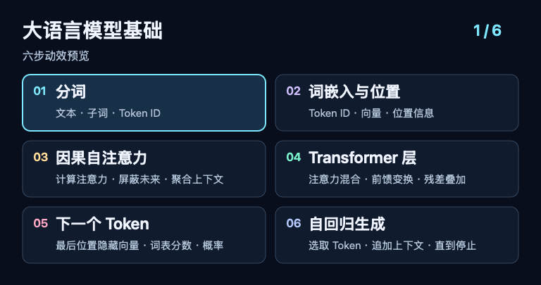
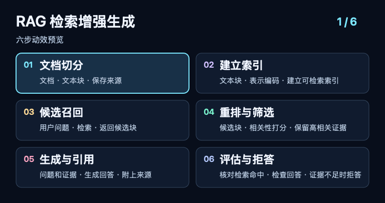
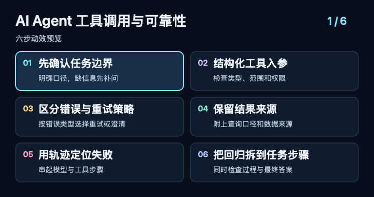
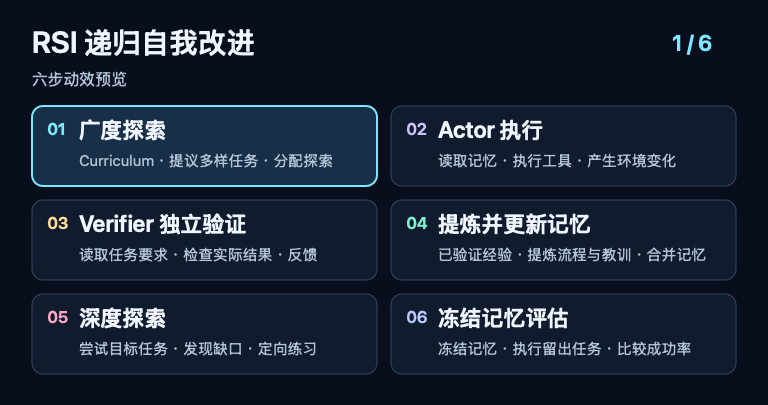

# AIC

从大语言模型到 RSI（递归自我改进）。每章六步，预览在仓库首页自动循环。点击图片打开对应章节的交互版。

## 01 · 大语言模型基础

## 02 · 预训练与推理

## 03 · LLM 后训练关键检查点

## 04 · RAG 检索增强生成

## 05 · AI Agent 工具调用与可靠性

## 06 · RSI 递归自我改进

[项目源码与运行说明](./knowledge-motion/README.md)
