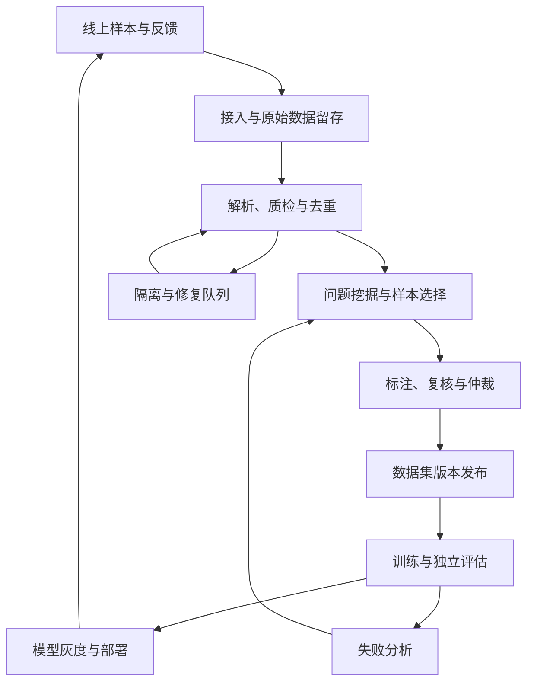

# Data Infra 与数据闭环链路：前期调研

调研日期：2026-11-23  
阶段：需求分析与架构调研，尚未实施或部署。

本目录独立于 AIC 动效项目。本文先以“服务 AI 模型迭代的数据基础设施”为研究范围，覆盖图像、视频以及 LLM / Agent 数据。业务规模、现有平台和时效要求尚未确定，因此以下架构是可讨论的设计建议，而非已确认的业务需求或性能承诺。官方能力与论文结论以 [S编号] 标注；其余流程、字段和验收方案是基于这些资料提出的工程设计。

## 1. 先明确：我们要建设什么

建议将目标定义为：**让线上问题能够转化为可追溯、可复现的数据改进，并验证这些改进是否提升模型与业务表现。**

数据回流只完成了采集；数据闭环还必须回答：问题来自哪个模型？哪些样本被选中？谁做了标注？进入哪个数据版本？如何训练和评估？上线后是否减少了原来的问题？

完整证据链为：

`线上反馈 → 问题批次 → 样本与标签版本 → 数据集发布版本 → 训练运行 → 评估报告 → 模型发布版本 → 部署与实际收益`

这与单纯建设数仓有区别：数仓通常侧重分析消费；模型数据闭环还需要管理多媒体对象、标注修订、训练成员清单、模型版本和反馈归因。两者可以共享基础设施。

论文依据：Sculley 等讨论了 ML 系统的数据依赖、隐藏反馈环和系统耦合造成的技术债；Sambasivan 等通过从业者访谈讨论了上游数据问题如何逐步传播。它们支持优先治理数据依赖和质量，但不直接证明某个技术栈适用于本项目。[S1][S2]

## 2. 端到端链路



这是一条逻辑链路，不意味着每一步都要建设一个独立服务。起步可以由对象存储、一个元数据库和批处理任务完成。

| 环节 | 核心工作 | 必须留下的产物 | 关键失败处理 |
|---|---|---|---|
| 接入 | 接收业务事件、媒体、推理日志 | 事件 ID、原始对象、来源和时间 | 重试去重、来源对账 |
| 处理 | 解码、抽帧、格式统一、元信息提取 | 处理版本、父子关系、输出校验值 | 隔离损坏对象，支持重跑 |
| 质检 | 完整性、重复、异常分布检查 | 规则版本、检查结果 | 阻断不合格批次或明确豁免 |
| 挖掘 | 错误、分歧、长尾和覆盖缺口发现 | 候选批次、入选原因 | 保留随机抽样，检查选择偏差 |
| 标注 | 任务分派、多轮复核、冲突仲裁 | 原始投票、修订、最终标签 | 未知、争议、拒绝单独建模 |
| 数据发布 | 固定成员、标签、划分和对象版本 | 不可变发布清单 | 校验完成后原子发布 |
| 训练评估 | 训练、切片评估、回归检查 | 运行 ID、配置、模型、报告 | 未通过门禁则保留现网模型 |
| 上线反馈 | 灰度、观测、回滚、收益归因 | 部署版本、实验分组、反馈批次 | 分析模型与数据两类退化 |

## 3. 架构分层：先划清职责

| 层次 | 管理对象 | 建议边界 |
|---|---|---|
| 原始对象层 | 图片、视频、文本文件、原始日志 | 内容不可原地覆盖；派生结果另存 |
| 数据与索引层 | 样本、标签、嵌入、结构化统计 | 大对象放对象存储，元数据进入数据库 |
| 控制层 | 任务状态、重试、发布、权限和审计 | 控制“哪些数据可以被使用” |
| 模型迭代层 | 数据集版本、训练、评估、模型发布 | 每次运行绑定具体输入与代码版本 |
| 反馈层 | 请求、预测、延迟到达的真值、业务结果 | 反馈必须关联当时的实际部署版本 |

**数据流转与状态流转要分开。** 媒体复制完成不代表处理成功；标签写入成功不代表数据集允许发布；模型文件生成不代表允许上线。

起步时 PostgreSQL 可以同时承载多个层次的元数据，按表与权限划分职责；不必为了图上的分层拆出大量微服务。

## 4. 首先设计身份、版本和血缘

### 4.1 最小实体模型

| 实体 | 推荐主键 | 主要字段与用途 |
|---|---|---|
| 接入事件 | event_id | source、schema_version、event_time、ingested_at |
| 原始资产 | asset_id | object_uri、object_version、content_sha256、来源、保留策略 |
| 样本 | sample_id | asset_id、时间片/区域、parent_sample_id、处理版本 |
| 重复关系 | duplicate_group_id | 精确/近似类型、算法版本、关系与相似度 |
| 推理记录 | prediction_id | sample_id、request_id、model_release_id、输出、耗时 |
| 标注修订 | annotation_revision_id | sample_id、任务、标签体系版本、投票、复核状态 |
| 数据集发布 | dataset_release_id | 成员清单地址与摘要、划分版本、标签版本 |
| 训练运行 | training_run_id | 数据发布 ID、代码提交、环境、配置、随机种子 |
| 模型发布 | model_release_id | 训练运行、权重摘要、评估报告、发布状态 |
| 部署 | deployment_id | 模型发布、预处理版本、路由/阈值、灰度分组 |
| 反馈 | feedback_id | prediction_id、反馈来源、发生时间、可用时间、修订版本 |
| 闭环迭代 | loop_iteration_id | 问题定义、候选批次、数据发布、模型、验收结论 |

模型版本之外还要记录预处理、后处理与阈值版本：相同权重可能因抽帧、归一化或阈值变化产生不同输出。

### 4.2 三个容易混淆的概念

1. **内容相同不等于业务事件相同。** 相同文件可对应不同来源或请求；内容哈希用于识别字节内容，事件 ID 用于识别事件，不能相互替代。
2. **近似重复不等于字节重复。** 视频转码、裁剪与抽帧需要父子关系或近似关系；直接用哈希无法消除这类训练/测试泄漏。
3. **任务血缘不等于样本血缘。** OpenLineage 提供 Job、Run、Dataset 等标准对象；帧来自哪个原视频、标签由哪个预测辅助生成，仍需要额外的样本级关联表。[S3]

### 4.3 时间至少保留三种

- event_time：业务事件实际发生时间。
- ingested_at：平台收到事件的时间。
- available_at：特征、标签或反馈实际可被系统使用的时间。

历史训练既要尊重事件时间，也要排除当时尚不可得的信息。例如 1 日发生、5 日确认的投诉，不能被当作 2 日已知的训练特征。Feast 文档介绍了基于事件时间和 TTL 的历史特征关联；本项目若使用延迟反馈，还需单独设计可用时间约束。[S4]

## 5. 可靠性：重点是可重试、可恢复、可对账

### 5.1 不把“Exactly Once”当成全链路保证

Kafka 文档区分了消息交付与处理语义。Kafka 范围内的事务能力，并不自动覆盖对象存储、标注平台、数据库和训练启动等外部副作用。[S5]

建议首版采用：**允许至少一次投递，通过业务幂等键与状态检查，使重复执行不会重复发布或重复产生有效产物。**

| 场景 | 建议机制 |
|---|---|
| 同一接入事件重复发送 | event_id 唯一约束；重复事件核对载荷摘要 |
| 同一对象重复处理 | 对象版本 + 处理器版本 + 配置摘要形成任务幂等键 |
| 标注回调重复或乱序 | 平台任务 ID + 修订 ID；保留历史，按明确规则选有效版本 |
| 数据库写入后事件发送失败 | 如存在消息总线，采用事务 Outbox 与可重放消费者 |
| Worker 中断 | 持久化状态、租约和超时回收；提交输出前检查任务归属 |
| 数据文件上传一半 | 暂存路径写入，校验完成后再发布元数据引用 |
| 任务长期失败 | 有界重试、隔离队列、人工修复后重新处理 |

任务状态可以从 `PENDING → RUNNING → SUCCEEDED` 开始，补充 `RETRYABLE_FAILED / QUARANTINED / CANCELLED`。状态转换应受数据库条件更新或事务保护，不能只依赖进程内变量。

### 5.2 数据集必须有明确的发布边界

建议发布流程：

1. 在 staging 中生成样本成员清单，固定每个成员的对象与标签修订。
2. 检查对象可读、摘要一致、标签有效、划分无冲突、受限样本未混入。
3. 写入不可变 manifest，并计算摘要。
4. 在元数据库事务中登记发布版本，将其状态切换为 READY。
5. 训练只读取 READY 的具体版本；消费者不能将 staging 目录当训练集。

对象存储与数据库不必拥有跨系统事务：先写完整对象，再原子发布引用；未被引用的暂存产物可由回收任务清理。回收必须避开正在发布或仍被引用的对象。

Iceberg 支持快照、分支、标签及其保留策略，可为大规模表数据提供版本管理基础；但单表快照不能替代覆盖多表、媒体对象和标签的训练发布清单。快照过期和对象清理策略还必须考虑训练复现需求。[S6]

## 6. 数据质量：同时检查“能否处理”和“是否适合学习”

| 质量维度 | 检查示例 | 不通过时的动作 |
|---|---|---|
| 结构 | 必填字段、类型、schema 兼容性 | 拒收或隔离，保留原因 |
| 媒体 | 解码、时长、尺寸、PTS、音视频对齐 | 隔离，避免静默丢样本 |
| 完整性 | 对象与索引对应、标签成员关系 | 阻断数据发布 |
| 重复与污染 | 重复文件、同源片段跨划分 | 重建划分或排除冲突成员 |
| 标签 | 标签范围、任务一致性、复核状态 | 退回复核；不自动填成负类 |
| 分布 | 类别、来源、设备、时段、失真程度 | 对比参考分布，分析告警 |
| 时间 | 时间异常、过期特征、反馈可用性 | 修正时间逻辑或排除样本 |
| 使用范围 | 来源、授权用途、保留/删除状态 | 按已确定的数据策略限制使用 |

**分布变化不是错误标签，也不自动证明模型退化。** 它是启动切片评估和问题调查的信号。规则应明确哪些失败会阻断发布，哪些只告警；阈值需要根据实际基线制定。

## 7. 样本挖掘：把标注预算花在可以验证的改进上

建议同时维护四类候选池：

| 池 | 如何产生 | 用途与注意点 |
|---|---|---|
| 已确认错误 | 人工复核、可信反馈与预测冲突 | 直接修复；需要控制重复来源 |
| 不确定/分歧 | 概率、集成分歧、多视角分歧 | 发现边界；置信度需校准或验证 |
| 覆盖缺口 | 新设备、长尾类别、稀缺场景 | 补覆盖；不等于必然提升总体指标 |
| 随机抽样 | 从目标线上总体独立抽取 | 估计总体表现、发现挖掘策略遗漏 |

不建议第一版就学习复杂采样策略。先用可解释的“池配额 + 分层抽样 + 去重 + 预算限制”，记录每个样本入选原因、策略版本和来源批次。

FiftyOne Brain 官方文档提供精确/近似重复、嵌入相似性等分析能力，可辅助媒体数据探索与候选检查；具体去重阈值和嵌入适配性仍需在本业务验证。[S7]

**高置信错误尤其值得单独挖掘。** 只采低置信样本会漏掉系统性误判。针对你的质量/流畅度场景，可检查多时间窗口分歧、原视频与抽帧结果不一致，以及有可信复核结果的高置信错误；这些是候选策略，尚未证明其收益。

## 8. 标注与反馈：保留不确定性和来源

### 8.1 推荐标注流程

任务说明与示例 → 小批试标 → 分歧分析 → 修订规范 → 正式标注 → 抽检/复核 → 冲突仲裁 → 标签版本冻结。

每条标注至少保留：任务定义、标签体系版本、标注者匿名 ID、原始结果、时间、是否参考模型预标注、预标注模型版本、复核者、修订原因和最终状态。

注意四点：

- 标注者“自信”与标签“客观可靠”不同，应结合金标检查、一致性和复核结果分析。
- 缺失标签、无法判断和明确负类必须区分；多标签归因尤其不能将未提及的缺陷一律视为不存在。
- 多人一致也可能共享偏差，需保留独立抽检与外部标准。
- 用户投诉、点击、停留等是带噪声的业务信号，未经验证不直接当作质量真值。

### 8.2 人工、模型和规则标签分开管理

Label Studio 支持将模型预测导入为预标注，交由标注者检查和修正；预标注与最终人工标签在本系统中应保留不同身份与关联。[S8]

Snorkel 展示了通过启发式标注函数构造弱监督的思路，并建模其未知准确率和相关性。这支持探索程序化标签，但不能据此认为任意规则或 LLM 自动标签都可信。[S9]

建议区分 `human_verified / model_pseudo / rule_weak / business_proxy`，并在数据发布清单中记录各来源占比、筛选方法与权重策略。独立评估集原则上使用与任务匹配、经过复核的参考标注。

## 9. 数据版本与训练复现

### 9.1 不能只保存“查询条件”

`SELECT ... WHERE reviewed=true` 的结果会随标签修订而变化。可复现的数据版本需要固定**当时究竟用了哪些样本、哪版标签和哪版对象**。

建议每个发布包含以下清单：

```yaml
dataset_release_id: fluency_example_001
task_schema_version: fluency_schema_01
members_uri: object://datasets/fluency_example_001/members.parquet
members_sha256: <actual_sha256>
split_policy_version: source_group_time_01
processing_code_commit: <git_commit>
processing_config_digest: <actual_digest>
quality_report_uri: object://datasets/fluency_example_001/quality.json
created_at: <timestamp>
status: READY
```

这是字段示例，`object://` 是说明性占位符。成员表逐行记录 sample_id、split、asset/object 版本、annotation_revision_id、来源分组等；URI 本身不保证不可变，要结合存储版本策略、访问控制和摘要验证。

### 9.2 训练/验证/测试隔离

- 按任务确定隔离单位：同视频及其派生片段通常不能跨训练与测试；同用户/同设备是否隔离，取决于希望测量的泛化目标。
- 需要评估时间泛化时，采用时间划分，并处理迟到标签和同源内容。
- 调参和门禁用验证/回归集，最终测试集保留严格访问规则；反复根据固定测试集结果选数会逐渐产生适应性过拟合。
- 线上随机抽检集与主动挖掘集分别统计；困难样本集的错误率不能直接外推为总体错误率。

MLflow Tracking 可记录运行、参数、代码、指标与产物；Model Registry 管理模型版本和别名。建议将 dataset_release_id、成员摘要和评估协议写入运行元数据。别名可以变动，部署记录仍需解析并保存具体模型版本。[S10][S11]

## 10. 如何证明闭环有效

### 10.1 先固定一次迭代的实验问题

例如：“增加新设备来源的复核视频，能否改善该来源的不流畅召回，同时维持总体误报和推理时延？”

最有解释力的首轮实验是：固定代码、模型结构、训练预算和评估协议，仅比较数据增量；再单独比较算法变化。条件无法完全固定时，报告混杂因素，不能把全部提升归因于数据。

| 指标层 | 推荐记录 | 解释边界 |
|---|---|---|
| 链路可靠性 | 事件对账差异、隔离率、任务重试、重复有效产物数 | 接收成功不代表发布成功 |
| 数据交付 | 从问题确认到 READY 的 p50/p95、标注复核通过率 | 对齐起止事件和批次范围 |
| 模型表现 | 分类召回/误报、macro-F1；回归按需用 SROCC/PLCC/MAE | 按任务选指标，保留来源切片 |
| 归因多标签 | 各类 AP、macro/micro AP、置信区间 | 未完整标注的负类会污染评估 |
| 生产服务 | p95 延迟、错误率、资源消耗 | 固定负载与硬件条件 |
| 实际收益 | 灰度组业务指标、已确认问题复发率 | 有延迟反馈时等待成熟窗口 |

建议定义：

`反馈关联率 = 可关联到有效预测记录的反馈数 / 同一成熟窗口内应关联的反馈数`

`数据发布通过率 = 通过全部必需门禁的发布尝试数 / 发布尝试总数`

`单位标注成本收益 = 同一评估协议下的指标变化 / 本轮新增有效标注成本`

最后一个指标只适合在实验条件可比时比较；随机波动、数据规模非线性以及负收益都要保留。每轮保存样本量、分层结果和不确定性，不把单个点估计当结论。

## 11. 技术选型：首版做小，扩容由瓶颈驱动

以下是建议组合，不代表组件已经安装、兼容性已验证或商业条款已经审核。

| 能力 | 首版候选 | 何时扩展 |
|---|---|---|
| 大对象存储 | 现有 S3 兼容对象存储或云存储 | 根据容量、带宽、冷热和跨区域需求规划 |
| 元数据与任务状态 | PostgreSQL | 实测查询/写入瓶颈后再分区或分离分析负载 |
| 数据处理 | Python Worker + Parquet | 批处理规模超出单机预算再评估 Spark/Ray |
| 编排 | 选一种现有编排器；Dagster/Airflow 二选一调研 | 需要资产依赖、补数、可观测性时强化 |
| 标注 | Label Studio 或已有标注平台 | 多角色权限、复杂仲裁、规模化质检需求 |
| 媒体探索 | 按需用 FiftyOne | 候选探索和近重复检查成为瓶颈时 |
| 训练与模型登记 | MLflow 或已有平台 | 与训练平台和部署平台打通 |
| 数据发布 | 不可变 manifest + 元数据库 | 表数据规模和并发演进需要时引入 Iceberg |
| 事件流 | 首版可用批接入/数据库任务 | 有持续高吞吐、多消费者、重放需求再用 Kafka |
| 实时计算 | 首版不预设 | 秒级窗口、状态计算、迟到处理需求明确后评估 Flink |
| 在线特征 | 首版不预设 | 结构化特征需训练/在线一致与低延迟复用时评估 Feast |
| 向量检索 | 小规模可先离线相似度分析 | 增量检索与延迟需求成立后评估 pgvector 等 |

首版推荐围绕 **对象存储 + PostgreSQL + 批处理/编排 + 标注平台 + MLflow + 发布清单** 完成一条闭环。若已有成熟组件，优先集成。Kafka、Flink、Iceberg 和 Feast 分别解决不同问题，不能视为 Data Infra 的固定套餐。

## 12. 参考场景：UGC 视频流畅度

此例用于验证架构是否具体，不代表已经确定后续业务就是流畅度评估。

1. **发现问题：** 随机抽检发现某设备来源的“不流畅”漏检，建立问题批次和可复核定义。
2. **接入证据：** 保存原视频、实际服务抽帧配置、模型/阈值版本、时间戳信息与当时输出；避免只保存一张无法反映时序的截图。
3. **候选扩展：** 通过来源切片、时序统计和模型分歧形成候选；保留随机对照样本。
4. **规范标注：** 先定义卡顿、低帧率与运动模糊的区分及判定窗口；原生帧率差异本身不自动等于“不流畅”。
5. **冻结数据：** 同原视频与派生片段放同一划分，固定人工标签修订和预处理版本。
6. **控制实验：** 比较原数据与增量数据训练结果，检查目标来源召回、总体误报、其他来源退化和时延。
7. **灰度验证：** 通过离线门禁后进入灰度，明确观察窗口与回滚条件。
8. **结束本轮：** 将实验结果绑定到 loop_iteration_id；若未改善，记录原因并调整采样或标签规范，不自动继续堆数据。

LLM / Agent 场景可以复用同一骨架，但数据单元应扩展为对话/任务轨迹，保留工具输入输出、环境版本、独立验证结果和隐私处理版本。任务成功、单步正确与用户满意需分开记录；轨迹截断片段也要避免跨划分泄漏。具体评估协议应另行调研。

## 13. 建设顺序与验收

| 阶段 | 交付物 | 完成标准 |
|---|---|---|
| A：明确任务 | 业务问题、输入/标签定义、规模与 SLA 表 | 能说清“哪类反馈推动哪种改进” |
| B：打通数据 | 接入契约、元数据表、处理任务、隔离队列 | 任一样本可追溯到原始来源与处理记录 |
| C：形成发布 | 标注修订、划分策略、manifest、质量报告 | 从具体发布版本完整读取训练输入 |
| D：连接模型 | 训练登记、评估门禁、模型与部署记录 | 从线上预测回查到数据版本与代码 |
| E：验证收益 | 独立评估、灰度报告、闭环迭代记录 | 至少完成一次有结论的迭代，包括失败结论 |

实现阶段必须验证以下故障场景：重复发送同一事件；处理到一半终止 Worker；标签修订乱序到达；数据文件缺失/摘要错误；模型灰度回滚。分别检查不会重复发布、能恢复处理、不会覆盖新标签、会阻断不完整版本、能恢复具体部署配置。

不在需求未明时承诺吞吐、分钟级时效或固定交付周数。容量设计至少需要：日增样本与字节量、峰值事件率、媒体平均时长、标注量/人力、保留周期、训练读取吞吐和可接受反馈延迟。

## 14. 下一步设计需要补齐的信息

1. 首个闭环的业务对象：图像、视频、LLM 对话还是 Agent 轨迹？
2. 闭环目标：质量提升、长尾修复、成本下降，还是模型线上可靠性？
3. 数据体量、峰值、保留周期及已有存储/计算/标注平台。
4. 反馈从哪里产生、多久成熟、可靠程度如何、是否能关联请求。
5. 哪些数据可训练、哪些只允许分析，谁负责标签和发布审批。
6. 首个任务的独立评估标准、灰度条件与回滚要求。

后续适合在本目录继续补充：正式需求、数据契约、实体关系、链路状态机、容量成本估算和首个场景原型。当前先完成调研，不混入 AIC 动效工作。

## 15. 原始资料与阅读建议

资料核查以论文原文入口和项目官方文档为主。动态文档会更新；本文不将网页中的 latest 等同于项目应采用的固定部署版本。实施时需锁定版本并核对权限、插件和部署差异。

| 编号 | 资料 | 本文使用范围 |
|---|---|---|
| S1 | Sculley et al., [Hidden Technical Debt in Machine Learning Systems](https://papers.neurips.cc/paper_files/paper/2015/hash/86df7dcfd896fcaf2674f757a2463eba-Abstract.html), NeurIPS 2015 | 数据依赖、隐藏反馈与系统技术债 |
| S2 | Sambasivan et al., [“Everyone wants to do the model work, not the data work”: Data Cascades in High-Stakes AI](https://research.google/pubs/everyone-wants-to-do-the-model-work-not-the-data-work-data-cascades-in-high-stakes-ai/), CHI 2021 | 数据问题的下游传播；访谈研究，不是本项目效果实验 |
| S3 | [OpenLineage Object Model](https://openlineage.io/docs/spec/object-model/) | Job / Run / Dataset 血缘对象 |
| S4 | [Feast Point-in-time joins](https://docs.feast.dev/getting-started/concepts/point-in-time-joins) | 历史特征关联与 TTL |
| S5 | [Apache Kafka Design](https://kafka.apache.org/41/design/design/) | 交付语义与外部系统边界；引用 4.1 文档，不代表版本推荐 |
| S6 | [Apache Iceberg Branching and Tagging](https://iceberg.apache.org/docs/latest/branching/) | 快照引用、分支、标签与保留 |
| S7 | [FiftyOne Brain](https://docs.voxel51.com/brain.html)；[Similarity](https://docs.voxel51.com/user_guide/similarity.html) | 重复、嵌入与相似度探索 |
| S8 | [Label Studio: Import pre-annotated data](https://labelstud.io/guide/predictions.html) | 模型预标注导入与人工检查 |
| S9 | Ratner et al., [Snorkel: Rapid Training Data Creation with Weak Supervision](https://arxiv.org/abs/1711.10160), 2017 预印本 | 标注函数与弱监督来源建模 |
| S10 | [MLflow Tracking](https://mlflow.org/docs/latest/ml/tracking/) | 运行、参数、代码、指标和产物跟踪 |
| S11 | [MLflow Model Registry](https://mlflow.org/docs/latest/model-registry/) | 模型版本、元信息与别名 |

建议阅读顺序：先 S1/S2 理解问题，再 S3/S5/S6 理解可靠性和血缘边界，最后结合实际业务选择 S7/S8/S10 等工具。本文的分层、数据模型和发布流程属于工程建议，需要在首个业务场景中验证。
